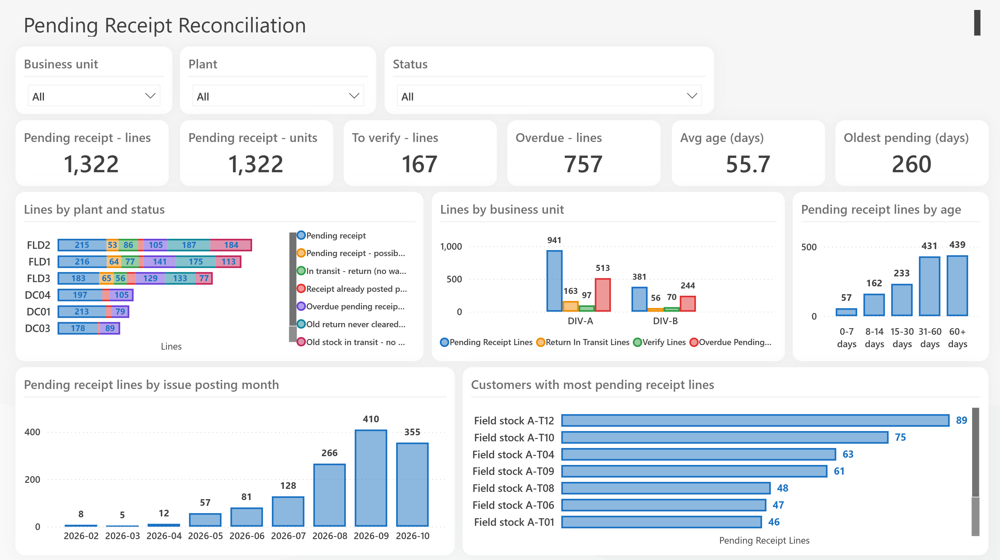
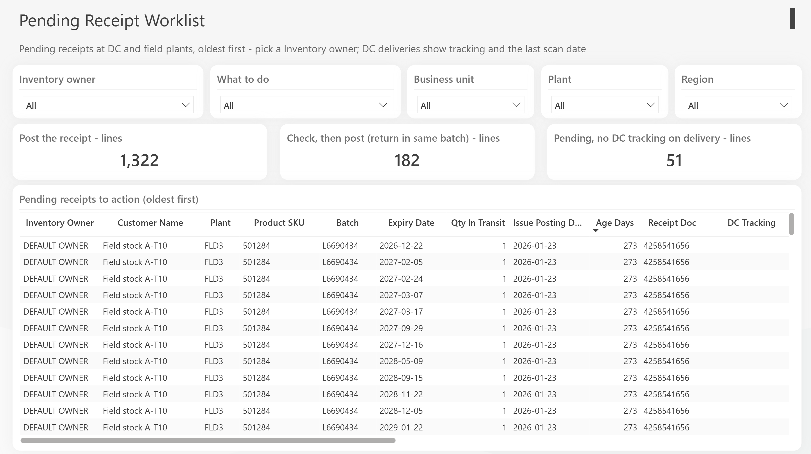

# Pending Receipt Reconciliation — Power BI demo

A Power BI project (PBIP/TMDL/PBIR) that finds **units that were issued but never receipt-confirmed**, works out *why*, and tells each owner what to do next.

**All data in this repository is synthetic.** It is generated by `data_gen/generate_demo_data.py` (seeded and reproducible: dates are anchored to `--today`, default 2026-10-23, so the same arguments always give the same files). Every name, plant, customer, document number and owner is fictional.





## What the model does

Five source tables (issue/receipt documents, field inventory, returns, delivery tracking, receipt history) are reduced to one row per in-transit unit. For each unit the model:

1. Builds a key (plant + material + batch) and nets **quantity issued − quantity received**.
2. Assigns one of seven statuses:

| # | Status | Meaning |
|---|---|---|
| 1 | Pending receipt | Issued, no receipt posted, recent enough to act on |
| 2 | Pending receipt – possible (return in same batch) | Likely a return of the same batch; check before posting |
| 3 | In transit – return (no warehouse receipt yet) | A return is on its way |
| 4 | Receipt already posted per extract – verify | Receipt exists in the extract; confirm and clear |
| 5 | Overdue pending receipt – issue older than 24 months | Escalate |
| 6 | Old return never cleared | Return with no warehouse receipt |
| 7 | Old stock in transit – no open issue or return | Unexplained; investigate |

3. Computes age (days and bucket), resolves the **inventory owner** through territory/region lookup keys (falling back to a default owner), and writes a plain-language **Next step**.

Pages: **Overview** (KPIs, status by plant, by business unit, age, issue month, top customers) and **Worklist** (slicers by owner / action / business unit / plant / region, oldest-first action table with delivery tracking and receipt history).

## Verifying the logic

The generator also writes `data/expected_status.csv`, the status each synthetic unit was *designed* to land in. After refresh, the model's counts by status and business unit match it exactly (3,516 units; status 1–7 = 1,322 / 182 / 219 / 167 / 757 / 495 / 374). Check with this DAX in DAX query view:

```dax
EVALUATE
SUMMARIZECOLUMNS ( PendingReceipt[Status Sort], PendingReceipt[BU], "n", COUNTROWS ( PendingReceipt ) )
ORDER BY PendingReceipt[Status Sort], PendingReceipt[BU]
```

## Open it

1. Copy this folder somewhere, e.g. `C:\PendingReceiptDemo\`.
2. Open `Pending Receipt Dashboard.pbip` in Power BI Desktop. If the data folder differs from `C:\PendingReceiptDemo\data\`, change the **DataFolder** parameter (Transform data → Manage parameters).
3. Refresh.

To regenerate the data: `python data_gen/generate_demo_data.py --out data` (needs `numpy` and `pandas`).

## Notes

- The report uses a third-party theme file (`sqlbi.json`); swap it under *View → Themes* if you prefer another.
- Power BI's PBIR validator reports some warnings against that theme file; Desktop opens and renders the report normally.
